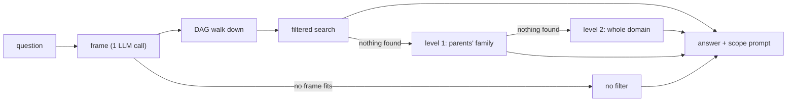

# Query localization: viva notes

The examiner's three notes, and where each one lives:

| Note | Answer in the code |
|---|---|
| 1. Categorize the policies | `shared/taxonomy/policy_taxonomy.yaml`: categories with parents (the **DAG**) and which document carries which |
| 2. Prompts from the categories | `scope_prompt()`: built from the frame description and the category descriptions in that yaml |
| 3. A frame or a DAG to localize the search | **Both**: a frame per kind of question, and the DAG walked down and up |

## 1. The problem, in three sentences

A plain search over a whole domain returns chunks from unrelated parts of the policy, so the model sees rules for the
wrong topic. The model answers from them, so the answer is confident and wrong. Localization narrows the search to the
part of the policy the question is about, and tells the model to say "I do not know" if the context does not answer it.

## 2. The five steps

1. **Question** arrives and is classified to a domain and authorized, as before.
2. **Frame**: one model call picks a frame from a numbered menu (`frame_query_node`). No fitting frame means no filter.
3. **DAG walk down**: the frame's categories are expanded to everything below them (`expand_with_descendants`).
   That is level 0. The walk *up* (`parents_family`) prepares level 1, used only if level 0 finds nothing.
4. **Filtered search, widening if needed**: level 0 = the frame's categories; level 1 = the parents' whole family;
   level 2 = the whole domain, no filter. Each level is tried once, and the first that finds something answers.
5. **Answer under a scope prompt**: the model is told the topic and to answer only from the context.



## 3. Three worked examples (real names from my yaml and frames)

The frame picks are what the model is *expected* to choose; I have not recorded live runs.

**"How many casual leaves do I get?"** → frame `hr.leave_entitlement` → categories `earned_leave, casual_and_sick_leave,
family_leave` (all leaves, nothing below them) → filter on those → scope prompt: "This question is about how many days
of a kind of leave an employee gets... The relevant policy areas are: earned_leave: ...; casual_and_sick_leave: ...".

**"Tell me about leave"** → frame `hr.leave_overview`, which names only the parent `leave` → the DAG walk adds its four
children: `leave, earned_leave, casual_and_sick_leave, family_leave, comp_off_and_lwp`. Chunks carry the *child* labels,
so without the walk a filter on `leave` alone would match almost nothing. This is the DAG doing real work.

**"Is PF deducted from my salary?"** → frame `hr.provident_fund` → `provident_fund_and_gratuity`. That category has
**two parents**, `payroll_and_tax` (it comes out of salary) and `benefits_and_expenses` (it is a retirement benefit).
Walking down from *either* parent reaches it (`tests/test_dag.py`). In a tree it would sit under only one of them.
If level 0 finds nothing, level 1 widens through **both** parents at once: `payroll_and_tax` and its children
(`salary_payment`, `salary_slip_and_tax_docs`) plus `benefits_and_expenses` and its children (`medical_insurance`,
`reimbursements_and_travel`).

## 4. Frame versus DAG

**The frame** is the structure for one query: a named kind of question (`hr.leave_entitlement`) tied to the categories
that answer it. It is how a free-text question turns into categories, and it is the only part that needs a model.

**The DAG** is the hierarchy over the policies: which categories sit under which. It is plain code, no model.
I kept both because they do different jobs: the frame chooses where to look, and the DAG says how far that reaches:
down (a parent covers its children) and, when a search finds nothing, up (the parents' whole family).
A frame can name a parent and let the DAG supply the children, so frames stay short and a new child category is
picked up without editing any frame.

## 5. Why this is not GraphRAG

GraphRAG builds an entity graph out of the document text automatically and searches over that graph. Mine is a small
**hand-written** category hierarchy used as a **metadata filter** on an ordinary vector plus keyword search. Nothing is
extracted from the documents, and no graph is searched; the DAG is only used to expand a category into the ones below it.

## 6. Every file in the localization path

| File | What it does | Lines |
|---|---|---|
| `shared/taxonomy/policy_taxonomy.yaml` | The categories, their parents, and document to category | 207 |
| `shared/taxonomy/taxonomy.py` | Loads and checks the taxonomy; **`descendants`, `expand_with_descendants` (down) and `parents_family` (up) are the DAG walk** | 250 |
| `shared/taxonomy/tagging.py` | The labels one chunk carries | 52 |
| `shared/taxonomy/chunk_ceator.py` | Lists stored chunks (used by the labelling script) | 17 |
| `.../orchestrator/.../frames/frames.yaml` | The 11 hand-written frames | 51 |
| `.../frames/models.py`, `registry.py`, `selection.py` | A frame; loading and checking frames; the menu and reading the choice | 10, 50, 19 |
| `.../frames/node.py` | `frame_query_node`, `choose_frame`, `debug_payload` | 92 |
| `.../frames/prompts.py` | `scope_prompt` | 11 |
| `supervisor.py`, `state.py`, `nodes.py`, `agent_factory.py`, `routes.py`, 2 x `config.py`, `schema.py` | Wiring: one node and edge, 6 state fields, both category levels into the request, scope into the prompt, `LOCALIZE` | about 50 |
| `.../retrieval-service/.../filters.py` | The category filter (unchanged) | 50 |
| `.../retrieval-service/.../namespace_router.py` | The search, and the widening ladder (level 1, then level 2) | about 25 of 121 |
| `scripts/label_documents.py` | Writes the labels onto stored chunks | 69 |
| `eval/localize_eval.py` | The evaluation, precise and coarse apart | 204 |

Runtime code (no tests, scripts or eval): about **600 lines** (about 545 in whole files plus about 55 of wiring).

## 7. When something fails

- **No frame fits**, the model call fails, or it answers a number off the menu: no frame, no category filter.
- **The filtered search returns nothing**: it widens one level at a time. Level 1 searches the parents' whole family
  (skipped when the frame's categories have no parent that adds anything). Level 2 searches the whole domain with no
  filter. Each level runs once and the first that finds something stops the ladder, so at most 3 searches.
  The response says `fallback_used` and `fallback_level` (0, 1 or 2); the orchestrator returns both in `debug`.
- `LOCALIZE=off`, or a denied user: the frame step does nothing.

## 8. Known limits

- **Labels are per document, not per chunk.** Two HR documents carry 16 and 12 categories, so every chunk of them
  matches almost any filter. 7 of the 10 yaml documents carry 3 or more categories. This is why the evaluation reports
  **precise** and **coarse** documents apart. Only 3 documents are precise (HR facilities register, IBM customer
  support, Docker best practices), so the precise rows rest on a few categories.
- **I had per-chunk labels and removed them on 29 Oct.** TODO: SAHARS: write the real reason here.
- **A wrong frame can hide the right chunk.** Widening only starts when a level finds nothing at all; a level that
  returns a few wrong chunks stops the ladder.
- **A new upload is labelled at upload only if its file name is already in `policy_taxonomy.yaml`.** Otherwise it is
  `uncategorized` until the yaml is updated and `label_documents.py` is run again.
- `label_documents.py` writes Pinecone only. The keyword (BM25) index gets its labels at upload, so editing the yaml
  later does not relabel those; a filtered keyword search then drops them and vector search carries on.
- The frame is chosen from the latest message alone, so a short follow-up ("and sick leave?") loses its topic.
- **Not run against live services.** Every test uses fakes. The commands below are the first live run.

## 9. How to run it (Windows PowerShell, uv)

Keys: `PINECONE_API_KEY`, `PINECONE_INDEX_NAME` in the root `.env`; `GROQ_API_KEY` in `services\orchestrator\.env`.

```powershell
uv run python scripts/label_documents.py                 # dry run: read the counts first
uv run python scripts/label_documents.py --apply         # then run it again: every count must be 0
$env:LOCALIZE = "on"
docker compose up -d --build --no-deps orchestrator retrieval-service ingestion-service
Invoke-RestMethod http://localhost:8003/health; Invoke-RestMethod http://localhost:8001/health   # both: "localize": "on"
# write eval\questions.jsonl yourself (copy eval\questions.example.jsonl; tune and test lines are both required)
uv run python eval/localize_eval.py frames  --questions eval/questions.jsonl
$env:INTERNAL_SHARED_SECRET = "<same as the orchestrator>"; $env:EVAL_EMPLOYEE_EMAIL = "<allowed employee e-mail>"
uv run python eval/localize_eval.py answers --questions eval/questions.jsonl --setting on
$env:LOCALIZE = "off"; docker compose up -d --no-deps orchestrator retrieval-service
uv run python eval/localize_eval.py answers --questions eval/questions.jsonl --setting off
uv run python eval/localize_eval.py report  --questions eval/questions.jsonl
```

Tests (fakes only): `python -m pytest shared scripts/tests eval/tests`, and `python -m pytest tests` inside each of
`services/orchestrator`, `services/retrieval-service`, `services/ingestion_service`.
