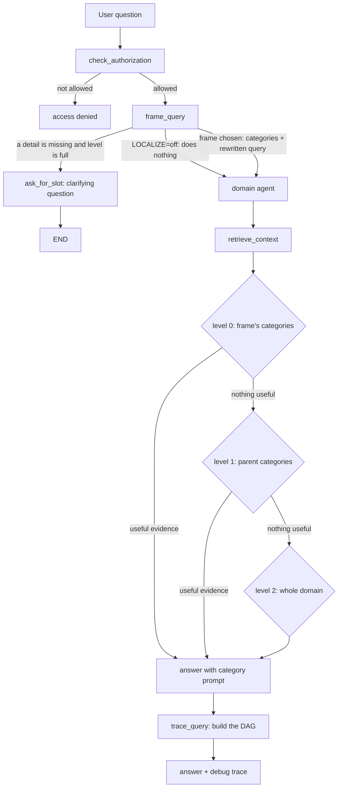

# Localized search: a walkthrough

This document explains the work done for the examiner's three notes, in plain words. It is written so that
someone who did not build it can follow it, and so that you can explain it in a viva.

> **Honest status.** The code is written and unit-tested with fakes (no network). Nothing here has been measured on
> real questions yet: the evaluation set in `eval/localize/` still contains only three format examples. So this
> document describes what the system *does*, not how *well* it does it. Do not quote any accuracy number from it.
>
> **AI assistance.** Most of this code was written with an AI coding assistant (Claude Code) in sessions with the
> author, who directed the work and reviewed it. Check your university's rule on declaring AI assistance and
> record it in the dissertation if it is required.

## 1. The three notes and the one-line answer to each

| Examiner's note | What was built |
|---|---|
| Categorize the policies | A taxonomy: every policy document has one or more categories, and every chunk takes its document's categories. Every stored chunk carries them. |
| Use the categories to create prompts | Short instructions per category, put into the answering prompt for the category the question belongs to. |
| A Frame / DAG for queries, to localize the search | Each question is sorted into a *frame* (a kind of question) that names the categories to search. A small graph (DAG) records the decision for each question. If nothing useful is found, the search widens step by step. |

Everything is behind one switch, `LOCALIZE`, with four levels. With `off` the system behaves exactly as before.

| Level | What is on |
|---|---|
| `off` | Nothing new. The default. |
| `filter` | The question is sorted into a frame and the search only looks inside that frame's categories. |
| `prompt` | `filter` plus the category instructions in the answering prompt. |
| `full` | `prompt` plus a clarifying question when a needed detail is missing. |

## 2. The journey of one question

Example question (made up for illustration): "How many days of earned leave do I get?"



In words:

1. **Authorization** runs first, as before.
2. **frame_query** shows the model a *closed numbered menu* of frames for the question's domain. The model answers
   with a number, the values it found for the frame's slots (for example `leave_type`), and a standalone version of
   the question. The code then checks everything the model said: an invalid number becomes the "other" frame; a slot
   value is kept only if it appears in the user's own words (or saved memories, never in an assistant reply); a
   rewritten question that contains numbers the user never wrote is refused. If anything fails, no frame is used
   and the system behaves like `off`.
3. If a required slot is missing and the level is `full`, the system **asks the user** instead of guessing.
4. Otherwise the **domain agent** searches. The retrieval service only returns chunks whose categories match and
   that are real content (menus and reference lists are marked `non_content` and excluded).
5. If that finds nothing useful, the search **widens**: first to the parents of the frame's categories (and their
   children), then to the whole domain. The level that finally answered is recorded.
6. The **answering prompt** gets a block of category instructions. Which closing rule it carries depends on where
   the evidence came from: *strict* ("answer only from these categories") for level 0, *widened* ("use a passage
   only if it really fits, and say where it comes from") for wider levels.
7. **trace_query** builds the DAG for the question and it is returned in an optional `debug` field of `/query`
   (and as one extra `{"debug": ...}` message in the stream, which the frontend ignores).

## 3. What each piece is for

Why a frame menu with numbers rather than free text? A model asked to "name the category" invents names. A closed
menu with numbers can be checked by code, and a wrong answer simply falls back to "other".

### New and changed files

| File | Why it exists / what changed |
|---|---|
| `shared/taxonomy/policy_taxonomy.yaml` | The taxonomy itself: categories per domain, parents (making it a DAG), and which document belongs to which categories. |
| `shared/taxonomy/taxonomy.py` | Loads and checks the taxonomy; answers "which categories does this chunk have?". |
| `shared/taxonomy/chunk_ceator.py` | Lists every chunk stored in Pinecone (used by `backfill.py`) and can write the document inventory. |
| `shared/taxonomy/tagging.py` | Turns a chunk's source into the metadata fields stored with it (`categories`, `is_content`, `title`). |
| `shared/taxonomy/taxonomy_inventory.md` | Human-readable inventory of the documents, used while writing the taxonomy. |
| `shared/contracts/schema.py` | New optional fields: `SourceItem.file_name`, `RetrievalQuery.categories`, `AgentAnswer.debug`. Optional, so old callers still work. |
| `scripts/backfill.py` | Adds the labels to chunks already stored in Pinecone and in the BM25 indexes. |
| `check_taxonomy.py` | Quick consistency check of the taxonomy file. |
| `services/ingestion_service/app/pinecone/upsert.py`, `app/api/route.py` | New uploads are tagged at ingestion, using the uploaded file name (the stored name is a temporary one). |
| `services/api-gateway/src/ingestion/ingestion.service.ts` | Sends the original `file_name` with an upload. |
| `services/retrieval-service/app/pinecone/filters.py` | Builds the Pinecone filter and the same rule for keyword (BM25) results. |
| `services/retrieval-service/app/pinecone/namespace_router.py`, `app/core/config.py` | Applies the filter only when `LOCALIZE` is not `off`; the `off` path is the old call unchanged. |
| `services/orchestrator/app/graph/frames/registry.py`, `models.py`, `frames.yaml` | The frame menu: a few hand-written frames plus one generated per leaf category plus "other". The three hand-written frames are marked EXAMPLE. |
| `.../frames/selection.py` | The checks on what the model returned (menu number, slot grounding, rewrite guard). |
| `.../frames/node.py` | The `frame_query` graph step, the routing after it, and the clarifying question. |
| `.../frames/widen.py` | The widening plan: own categories, then parents' family, then whole domain. |
| `.../frames/prompts.py`, `category_prompts.yaml` | Per-category instructions, their validation, and the three prompt variants. The instructions contain no digits, so they cannot carry policy figures. |
| `.../frames/dag.py` | Builds the per-question DAG and the `debug` payload. |
| `services/orchestrator/app/graph/supervisor.py`, `state.py` | Wires the new steps into the graph; new state fields. |
| `.../agents/base/agent_factory.py`, `nodes.py` | Retrieval follows the widening levels; the retry limit is relaxed while widening is still possible; the prompt block is added before the context. |
| `services/orchestrator/app/api/routes.py`, `app/core/config.py` | Returns the optional `debug`; reads `LOCALIZE`. |
| `docker-compose.yml` | One `LOCALIZE` value passed to both the orchestrator and the retrieval service (default `off`). |
| `eval/localize/*` | The evaluation harness (section 6). |

## 4. Alternatives that were considered

| Alternative | Why it was not chosen |
|---|---|
| Let the model name a category freely | Cannot be validated; invents names. The closed numbered menu can be checked. |
| Train a classifier for the category | Needs labelled questions that do not exist yet, and adds a model to maintain. |
| Filter only inside the vector search | BM25 (keyword) results would ignore the filter, so the two searches would disagree. Both use the same rule. |
| One category per chunk (a tree) | Real policies overlap (leave rules inside a handbook of many topics), so categories can have several parents. |
| Always use the strict prompt rule | After widening the evidence legitimately comes from a neighbouring category; the strict rule would contradict the evidence it was given. |
| Hard failure when a frame cannot be chosen | A failure in the extra step would make the system worse than `off`. It falls back to `off` behaviour instead. |
| Re-ingest everything to add labels | Slow and costs embeddings; the backfill only updates metadata. |

## 5. Known limits

- Chunks already stored have synthetic document ids (`src-...`), because they were ingested before documents had ids.
- 10 stale chunks in the BM25 index were labelled `uncategorized`; the `support` namespace has no BM25 index; the
  `coding` namespace is outside the taxonomy.
- A new upload whose file name is not in the YAML is `uncategorized` and is only reachable at the widest level.
- The debug trace is not exposed on the resume endpoints.
- The old `route_to_agent` function in `supervisor.py` is no longer used.
- Nothing has been run end to end through the real running services, and the quality of answers with the new
  prompts has not been measured.

## 6. Running things (Windows, PowerShell, uv)

The ordered, step-by-step version with expected output is in [RUNBOOK.md](RUNBOOK.md).

From the repository root unless stated.

**Tests** (they use fakes; no network or keys needed):

```powershell
cd shared;                       uv run python -m pytest taxonomy/tests ; cd ..
uv run python -m pytest scripts/tests
cd services\orchestrator;        uv run python -m pytest tests ; cd ..\..
cd services\retrieval-service;   uv run python -m pytest tests ; cd ..\..
cd services\ingestion_service;   uv run python -m pytest tests ; cd ..\..
uv run python -m pytest eval/localize/tests
```

**Backfill labels onto existing chunks** (a dry run by default; it only changes anything with `--apply`):

```powershell
uv run python scripts/backfill.py                    # dry run, prints the plan
uv run python scripts/backfill.py --namespace hr     # one namespace
uv run python scripts/backfill.py --apply            # writes the labels
```

**Turn localization on** (rebuild the two services that read the switch):

```powershell
$env:LOCALIZE = "full"        # off | filter | prompt | full
docker compose up -d --build --no-deps orchestrator retrieval-service
```

The ingestion service and the API gateway also changed (tagging at upload), so rebuild them once as well.

**Evaluate** (after writing `eval/localize/questions.jsonl`; see `eval/localize/README.md`):

```powershell
uv run python eval/localize/runner.py run --level off --questions eval/localize/questions.jsonl
uv run python eval/localize/runner.py report --questions eval/localize/questions.jsonl
```

## 7. What to say in a viva

- The categories are a DAG, not a tree, because a topic can belong to a broader family and to a narrower one.
- The model is only trusted to pick a number from a menu; code checks everything else, and any failure means the
  system behaves exactly like `off`.
- Widening is the safety net: a wrong frame costs extra searches, not a wrong "I don't know".
- The evaluation compares four levels on the same questions, separates tuning questions from held-out ones, and
  reports "n/a" where a level cannot be measured. The numbers are not in yet; they come from running the harness.
